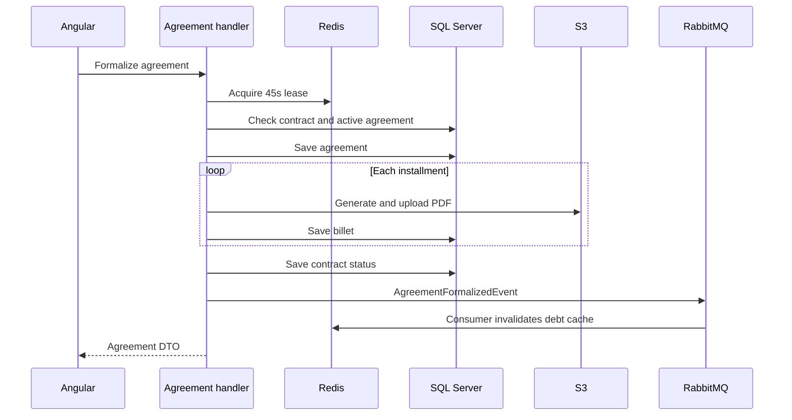

# Application & CQRS

Application for collection contracts, debt calculation, agreement negotiation and installment documents. The backend is C#/.NET despite the -c suffix. Generated payment slips/codes are demonstrative: formalization does not register a bank charge or confirm bank payment.

## Implemented behavior

ASP.NET Core net9.0 with EF Core 9.0.2/SQL Server, MediatR 14.1, FluentValidation, MassTransit 8.3.1/RabbitMQ, Redis and QuestPDF 2026.2.4; Angular 19.2.19, TypeScript 5.7 and RxJS 7.8 frontend. API, Application, Domain and Infrastructure separate HTTP, commands/queries, entities and adapters. LocalStack can provide S3. SQL, S3 and RabbitMQ do not automatically share a distributed transaction.

## Related files

- [backend/Application/Commands/CreateAgreementCommandHandler.cs](https://github.com/Vidigal-code/invoice-generator-c/blob/b1c5e2caf2d2a95fb06005b0d61d64792950207c/backend/Application/Commands/CreateAgreementCommandHandler.cs)
- [backend/Application/Consumers/AgreementFormalizedConsumer.cs](https://github.com/Vidigal-code/invoice-generator-c/blob/b1c5e2caf2d2a95fb06005b0d61d64792950207c/backend/Application/Consumers/AgreementFormalizedConsumer.cs)
- [backend/Application/Debt/InvoiceGeneratorCDebtCalculationStrategy.cs](https://github.com/Vidigal-code/invoice-generator-c/blob/b1c5e2caf2d2a95fb06005b0d61d64792950207c/backend/Application/Debt/InvoiceGeneratorCDebtCalculationStrategy.cs)
- [backend/Application/Services/Contracts/ContractAccessService.cs](https://github.com/Vidigal-code/invoice-generator-c/blob/b1c5e2caf2d2a95fb06005b0d61d64792950207c/backend/Application/Services/Contracts/ContractAccessService.cs)
- [backend/Application/Queries/GetBilletPdfQueryHandler.cs](https://github.com/Vidigal-code/invoice-generator-c/blob/b1c5e2caf2d2a95fb06005b0d61d64792950207c/backend/Application/Queries/GetBilletPdfQueryHandler.cs)
- [backend/Infrastructure/Configuration/AppSettings.cs](https://github.com/Vidigal-code/invoice-generator-c/blob/b1c5e2caf2d2a95fb06005b0d61d64792950207c/backend/Infrastructure/Configuration/AppSettings.cs)
- [docker-compose.yml](https://github.com/Vidigal-code/invoice-generator-c/blob/b1c5e2caf2d2a95fb06005b0d61d64792950207c/docker-compose.yml)
- [backend/Infrastructure/Repositories/GenericRepository.cs](https://github.com/Vidigal-code/invoice-generator-c/blob/b1c5e2caf2d2a95fb06005b0d61d64792950207c/backend/Infrastructure/Repositories/GenericRepository.cs)

## Navigation

- [Project guide](?menu=en&lang=en&id=19)
- [Source reference](?menu=en&lang=en&id=20)
