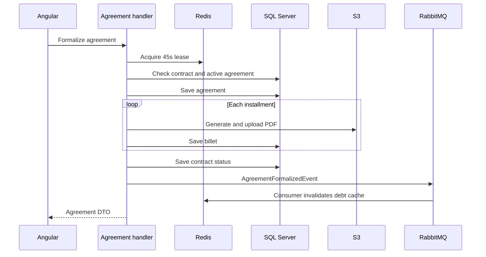

# invoice-generator-c: Project context and workflows

GitPageDocs **0.0.17** · 1.0.0 · 2026-10-29

## Context

Application for collection contracts, debt calculation, agreement negotiation and installment documents. The backend is C#/.NET despite the -c suffix. Generated payment slips/codes are demonstrative: formalization does not register a bank charge or confirm bank payment.

## Stack and architecture

ASP.NET Core net9.0 with EF Core 9.0.2/SQL Server, MediatR 14.1, FluentValidation, MassTransit 8.3.1/RabbitMQ, Redis and QuestPDF 2026.2.4; Angular 19.2.19, TypeScript 5.7 and RxJS 7.8 frontend. API, Application, Domain and Infrastructure separate HTTP, commands/queries, entities and adapters. LocalStack can provide S3. SQL, S3 and RabbitMQ do not automatically share a distributed transaction.

## End-to-end workflows

1. Registration → password/user validation → password hashing → login → JWT and HttpOnly/Secure/SameSite=Strict cookie. Login also returns Token in JSON. Controllers and ContractAccessService enforce roles and contract access. AdminPanel handles user/contract administration; the HTTP catalog is in the reference.

2. Contract → installments → portfolio-specific calculation. Per installment, daysOverdue=max(0, referenceDate-dueDate); penalty=principal×percent/100 only when overdue; interest=principal×(monthlyRate/100/daysPerMonth)×daysOverdue. Rates come from AppSettings; invalid daysPerMonth falls back to 30. CurrentValue sums principal, penalty and interest. The query uses cache and checks contract access.

3. Formalization validates 1–24 installments, acquires Redis formalize:{contractId} for 45 seconds and checks access/active agreements. Lock failure returns 409; an active agreement returns 400. It creates Agreement/Billets, divides the amount rounded to two decimals and uses 30-day due-date intervals. QuestPDF generates PDFs in the handler before event publication.

4. Each PDF goes to storage; upload failure makes the handler store a mock URL. The contract becomes Negotiated and publishes AgreementFormalizedEvent. The consumer invalidates the debt cache and records idem:agreement:{id} in Redis for 30 days; it does not generate PDFs. Payment-slip queries check access and attempt PDF retrieval with an HTML fallback in the service.

5. GenericRepository.AddAsync and UpdateAsync call SaveChangesAsync immediately. Agreement is persisted before the PDF loop, each Billet after upload, and the contract before the event. The entire formalization has no wrapping transaction; intermediate failure can leave a partial agreement/installments. Inspect persisted state before retrying.

## Data, security and limitations

Core entities: User/Role, Contract/Installment, Agreement/Billet, ContractHistory and AuditLog. Validation uses FluentValidation/domain rules; contract access is shared by queries and formalization. Storage has an AES-GCM payload protector. Payload encryption is not log anonymization. The lock has a fixed expiry; consumer deduplication is check-then-write, not an exactly-once guarantee. Uniform rounding can leave a residual difference between installments and the negotiated total.

## Setup, testing and operations

Copy envexample.txt to .env and configure local values. Docker Compose includes SQL Server/bootstrap, API, Redis, RabbitMQ, Elasticsearch, LocalStack and Angular. Effective ports come from Compose. Outside Docker, use .NET 9 SDK and frontend npm ci; prestart/prebuild synchronize root environment. Validate dotnet test, dotnet build, npm test and npm run build. For missing slips check PdfUrl/S3/fallback; stale debt values require cache/consumer checks; 409 requires lock inspection. The existing workflow publishes documentation, not these services.

## Complete reference

Dependencies, commands, endpoints, variables, contracts and tests are in the [source reference](?menu=en&lang=en&id=20).

## Verifiable sources

- [backend/Application/Commands/CreateAgreementCommandHandler.cs](https://github.com/Vidigal-code/invoice-generator-c/blob/b1c5e2caf2d2a95fb06005b0d61d64792950207c/backend/Application/Commands/CreateAgreementCommandHandler.cs)

- [backend/Application/Consumers/AgreementFormalizedConsumer.cs](https://github.com/Vidigal-code/invoice-generator-c/blob/b1c5e2caf2d2a95fb06005b0d61d64792950207c/backend/Application/Consumers/AgreementFormalizedConsumer.cs)

- [backend/Application/Debt/InvoiceGeneratorCDebtCalculationStrategy.cs](https://github.com/Vidigal-code/invoice-generator-c/blob/b1c5e2caf2d2a95fb06005b0d61d64792950207c/backend/Application/Debt/InvoiceGeneratorCDebtCalculationStrategy.cs)

- [backend/Application/Services/Contracts/ContractAccessService.cs](https://github.com/Vidigal-code/invoice-generator-c/blob/b1c5e2caf2d2a95fb06005b0d61d64792950207c/backend/Application/Services/Contracts/ContractAccessService.cs)

- [backend/Application/Queries/GetBilletPdfQueryHandler.cs](https://github.com/Vidigal-code/invoice-generator-c/blob/b1c5e2caf2d2a95fb06005b0d61d64792950207c/backend/Application/Queries/GetBilletPdfQueryHandler.cs)

- [backend/Infrastructure/Configuration/AppSettings.cs](https://github.com/Vidigal-code/invoice-generator-c/blob/b1c5e2caf2d2a95fb06005b0d61d64792950207c/backend/Infrastructure/Configuration/AppSettings.cs)

- [docker-compose.yml](https://github.com/Vidigal-code/invoice-generator-c/blob/b1c5e2caf2d2a95fb06005b0d61d64792950207c/docker-compose.yml)

- [backend/Infrastructure/Repositories/GenericRepository.cs](https://github.com/Vidigal-code/invoice-generator-c/blob/b1c5e2caf2d2a95fb06005b0d61d64792950207c/backend/Infrastructure/Repositories/GenericRepository.cs)
