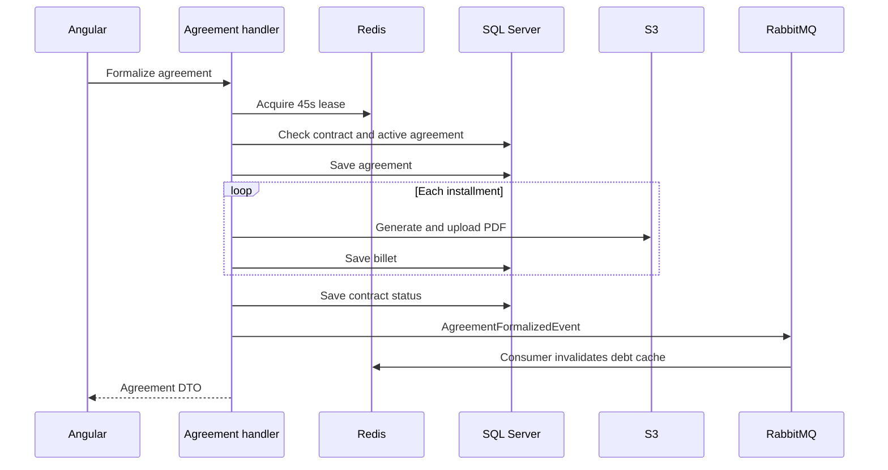

# Visión General de la Arquitectura

Aplicación de contratos de cobro, cálculo de deuda, negociación y documentos de cuotas. El backend es C#/.NET pese al sufijo -c. Los documentos y códigos son demostrativos: formalizar no registra un cobro bancario ni confirma un pago.

## Comportamiento implementado

ASP.NET Core net9.0 con EF Core 9.0.2/SQL Server, MediatR 14.1, FluentValidation, MassTransit 8.3.1/RabbitMQ, Redis y QuestPDF 2026.2.4; frontend Angular 19.2.19, TypeScript 5.7 y RxJS 7.8. API, Application, Domain e Infrastructure separan HTTP, comandos/queries, entidades y adaptadores. LocalStack puede ofrecer S3. SQL, S3 y RabbitMQ no comparten automáticamente una transacción distribuida.

## Archivos relacionados

- [backend/Application/Commands/CreateAgreementCommandHandler.cs](https://github.com/Vidigal-code/invoice-generator-c/blob/b1c5e2caf2d2a95fb06005b0d61d64792950207c/backend/Application/Commands/CreateAgreementCommandHandler.cs)
- [backend/Application/Consumers/AgreementFormalizedConsumer.cs](https://github.com/Vidigal-code/invoice-generator-c/blob/b1c5e2caf2d2a95fb06005b0d61d64792950207c/backend/Application/Consumers/AgreementFormalizedConsumer.cs)
- [backend/Application/Debt/InvoiceGeneratorCDebtCalculationStrategy.cs](https://github.com/Vidigal-code/invoice-generator-c/blob/b1c5e2caf2d2a95fb06005b0d61d64792950207c/backend/Application/Debt/InvoiceGeneratorCDebtCalculationStrategy.cs)
- [backend/Application/Services/Contracts/ContractAccessService.cs](https://github.com/Vidigal-code/invoice-generator-c/blob/b1c5e2caf2d2a95fb06005b0d61d64792950207c/backend/Application/Services/Contracts/ContractAccessService.cs)
- [backend/Application/Queries/GetBilletPdfQueryHandler.cs](https://github.com/Vidigal-code/invoice-generator-c/blob/b1c5e2caf2d2a95fb06005b0d61d64792950207c/backend/Application/Queries/GetBilletPdfQueryHandler.cs)
- [backend/Infrastructure/Configuration/AppSettings.cs](https://github.com/Vidigal-code/invoice-generator-c/blob/b1c5e2caf2d2a95fb06005b0d61d64792950207c/backend/Infrastructure/Configuration/AppSettings.cs)
- [docker-compose.yml](https://github.com/Vidigal-code/invoice-generator-c/blob/b1c5e2caf2d2a95fb06005b0d61d64792950207c/docker-compose.yml)
- [backend/Infrastructure/Repositories/GenericRepository.cs](https://github.com/Vidigal-code/invoice-generator-c/blob/b1c5e2caf2d2a95fb06005b0d61d64792950207c/backend/Infrastructure/Repositories/GenericRepository.cs)

## Navegación

- [Project guide](?menu=es&lang=es&id=19)
- [Source reference](?menu=es&lang=es&id=20)
