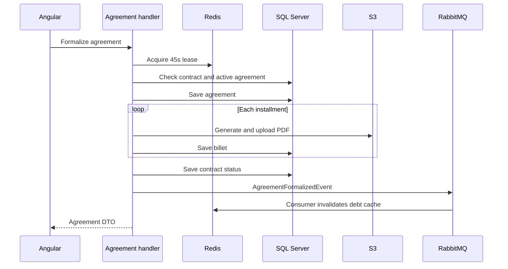

# invoice-generator-c: Contexto y flujos del proyecto

GitPageDocs **0.0.17** · 1.0.0 · 2026-10-29

## Contexto

Aplicación de contratos de cobro, cálculo de deuda, negociación y documentos de cuotas. El backend es C#/.NET pese al sufijo -c. Los documentos y códigos son demostrativos: formalizar no registra un cobro bancario ni confirma un pago.

## Stack y arquitectura

ASP.NET Core net9.0 con EF Core 9.0.2/SQL Server, MediatR 14.1, FluentValidation, MassTransit 8.3.1/RabbitMQ, Redis y QuestPDF 2026.2.4; frontend Angular 19.2.19, TypeScript 5.7 y RxJS 7.8. API, Application, Domain e Infrastructure separan HTTP, comandos/queries, entidades y adaptadores. LocalStack puede ofrecer S3. SQL, S3 y RabbitMQ no comparten automáticamente una transacción distribuida.

## Flujos completos

1. Registro → validación de contraseña/usuario → hash → login → JWT y cookie HttpOnly/Secure/SameSite=Strict. Login también devuelve Token en JSON. Controllers y ContractAccessService aplican roles y acceso al contrato. AdminPanel administra usuarios/contratos; el catálogo HTTP está en la referencia.

2. Contrato → cuotas → cálculo por cartera. Por cuota, díasAtraso=max(0, fechaReferencia-vencimiento); multa=principal×porcentaje/100 solo con atraso; interés=principal×(tasaMensual/100/díasMes)×díasAtraso. Las tasas vienen de AppSettings; díasMes inválido usa 30. CurrentValue suma principal, multa e interés. La query usa caché y comprueba acceso.

3. La formalización valida 1–24 cuotas, adquiere Redis formalize:{contractId} durante 45 segundos y comprueba acceso/acuerdos activos. Fallo de bloqueo: 409; acuerdo activo: 400. Crea Agreement/Billets, divide el valor redondeando a dos decimales y fija vencimientos cada 30 días. QuestPDF genera los PDFs en el handler antes del evento.

4. Cada PDF va al almacenamiento; si falla el upload, el handler guarda una URL mock. El contrato pasa a Negotiated y publica AgreementFormalizedEvent. El consumer invalida caché de deuda y guarda idem:agreement:{id} en Redis durante 30 días; no genera PDFs. La consulta verifica acceso e intenta recuperar PDF con fallback HTML.

5. GenericRepository.AddAsync y UpdateAsync llaman SaveChangesAsync inmediatamente. Agreement se guarda antes del bucle PDF, cada Billet después del upload y el contrato antes del evento. No existe transacción global de formalización; un fallo puede dejar acuerdo/cuotas parciales. Inspeccione estado antes de repetir.

## Datos, seguridad y límites

Entidades centrales: User/Role, Contract/Installment, Agreement/Billet, ContractHistory y AuditLog. FluentValidation y dominio validan; consultas y formalización comparten control de acceso. El almacenamiento tiene protección AES-GCM de payload. Eso no anonimiza logs. El bloqueo tiene caducidad fija; deduplicar mediante consulta y escritura no garantiza exactly-once. El redondeo puede dejar diferencia residual entre cuotas y total.

## Ejecución, pruebas y operación

Copie envexample.txt a .env y configure valores locales. Compose reúne SQL Server/inicialización, API, Redis, RabbitMQ, Elasticsearch, LocalStack y Angular. Use sus puertos efectivos. Fuera de Docker use SDK .NET 9 y npm ci en frontend; prestart/prebuild sincronizan el entorno raíz. Valide dotnet test/build y npm test/build. Si falta un documento revise PdfUrl/S3/fallback; si la deuda está obsoleta revise caché/consumer; ante 409 revise el lock. El workflow publica documentación, no estos servicios.

## Referencia completa

Dependencias, comandos, endpoints, variables, contratos y pruebas están en la [referencia del código](?menu=es&lang=es&id=20).

## Fuentes verificables

- [backend/Application/Commands/CreateAgreementCommandHandler.cs](https://github.com/Vidigal-code/invoice-generator-c/blob/b1c5e2caf2d2a95fb06005b0d61d64792950207c/backend/Application/Commands/CreateAgreementCommandHandler.cs)

- [backend/Application/Consumers/AgreementFormalizedConsumer.cs](https://github.com/Vidigal-code/invoice-generator-c/blob/b1c5e2caf2d2a95fb06005b0d61d64792950207c/backend/Application/Consumers/AgreementFormalizedConsumer.cs)

- [backend/Application/Debt/InvoiceGeneratorCDebtCalculationStrategy.cs](https://github.com/Vidigal-code/invoice-generator-c/blob/b1c5e2caf2d2a95fb06005b0d61d64792950207c/backend/Application/Debt/InvoiceGeneratorCDebtCalculationStrategy.cs)

- [backend/Application/Services/Contracts/ContractAccessService.cs](https://github.com/Vidigal-code/invoice-generator-c/blob/b1c5e2caf2d2a95fb06005b0d61d64792950207c/backend/Application/Services/Contracts/ContractAccessService.cs)

- [backend/Application/Queries/GetBilletPdfQueryHandler.cs](https://github.com/Vidigal-code/invoice-generator-c/blob/b1c5e2caf2d2a95fb06005b0d61d64792950207c/backend/Application/Queries/GetBilletPdfQueryHandler.cs)

- [backend/Infrastructure/Configuration/AppSettings.cs](https://github.com/Vidigal-code/invoice-generator-c/blob/b1c5e2caf2d2a95fb06005b0d61d64792950207c/backend/Infrastructure/Configuration/AppSettings.cs)

- [docker-compose.yml](https://github.com/Vidigal-code/invoice-generator-c/blob/b1c5e2caf2d2a95fb06005b0d61d64792950207c/docker-compose.yml)

- [backend/Infrastructure/Repositories/GenericRepository.cs](https://github.com/Vidigal-code/invoice-generator-c/blob/b1c5e2caf2d2a95fb06005b0d61d64792950207c/backend/Infrastructure/Repositories/GenericRepository.cs)
