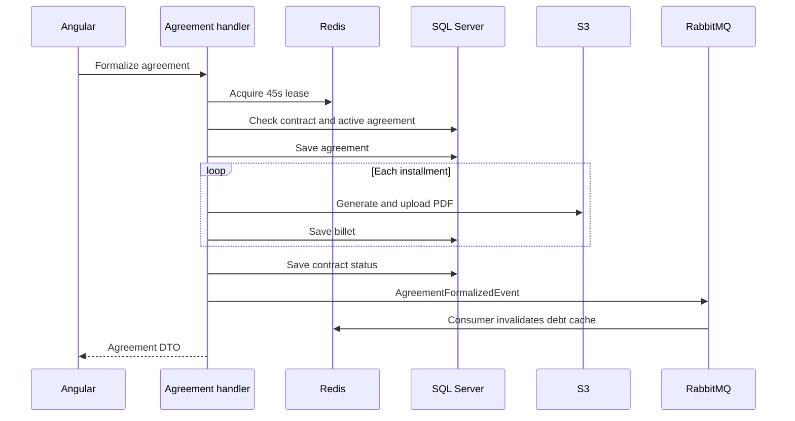

# invoice-generator-c: Contexto y flujos del proyecto

GitPageDocs **0.0.23** · 1.0.0 · 2026-11-08

## Contexto

Aplicación de contratos de cobro, cálculo de deuda, negociación y documentos de cuotas. El backend es C#/.NET pese al sufijo -c. Los documentos y códigos son demostrativos: formalizar no registra un cobro bancario ni confirma un pago.

## Stack y arquitectura

ASP.NET Core net9.0 con EF Core 9.0.2/SQL Server, MediatR 14.1, FluentValidation, MassTransit 8.3.1/RabbitMQ, Redis y QuestPDF 2026.2.4; frontend Angular 19.2.19, TypeScript 5.7 y RxJS 7.8. API, Application, Domain e Infrastructure separan HTTP, comandos/queries, entidades y adaptadores. LocalStack puede ofrecer S3. SQL, S3 y RabbitMQ no comparten automáticamente una transacción distribuida.



## Flujos completos

1. Registro → validación de contraseña/usuario → hash → login → JWT y cookie HttpOnly/Secure/SameSite=Strict. Login también devuelve Token en JSON. Controllers y ContractAccessService aplican roles y acceso al contrato. AdminPanel administra usuarios/contratos; el catálogo HTTP está en la referencia.

2. Contrato → cuotas → cálculo por cartera. Por cuota, díasAtraso=max(0, fechaReferencia-vencimiento); multa=principal×porcentaje/100 solo con atraso; interés=principal×(tasaMensual/100/díasMes)×díasAtraso. Las tasas vienen de AppSettings; díasMes inválido usa 30. CurrentValue suma principal, multa e interés. La query usa caché y comprueba acceso.

3. La formalización valida 1–24 cuotas, adquiere Redis formalize:{contractId} durante 45 segundos y comprueba acceso/acuerdos activos. Fallo de bloqueo: 409; acuerdo activo: 400. Crea Agreement/Billets, divide el valor redondeando a dos decimales y fija vencimientos cada 30 días. QuestPDF genera los PDFs en el handler antes del evento.

4. Cada PDF va al almacenamiento; si falla el upload, el handler guarda una URL mock. El contrato pasa a Negotiated y publica AgreementFormalizedEvent. El consumer invalida caché de deuda y guarda idem:agreement:{id} en Redis durante 30 días; no genera PDFs. La consulta verifica acceso e intenta recuperar PDF con fallback HTML.

5. GenericRepository.AddAsync y UpdateAsync llaman SaveChangesAsync inmediatamente. Agreement se guarda antes del bucle PDF, cada Billet después del upload y el contrato antes del evento. No existe transacción global de formalización; un fallo puede dejar acuerdo/cuotas parciales. Inspeccione estado antes de repetir.

## Datos, seguridad y límites

Entidades centrales: User/Role, Contract/Installment, Agreement/Billet, ContractHistory y AuditLog. FluentValidation y dominio validan; consultas y formalización comparten control de acceso. El almacenamiento tiene protección AES-GCM de payload. Eso no anonimiza logs. El bloqueo tiene caducidad fija; deduplicar mediante consulta y escritura no garantiza exactly-once. El redondeo puede dejar diferencia residual entre cuotas y total.

## Ejecución, pruebas y operación

Copie envexample.txt a .env y configure valores locales. Compose reúne SQL Server/inicialización, API, Redis, RabbitMQ, Elasticsearch, LocalStack y Angular. Use sus puertos efectivos. Fuera de Docker use SDK .NET 9 y npm ci en frontend; prestart/prebuild sincronizan el entorno raíz. Valide dotnet test/build y npm test/build. Si falta un documento revise PdfUrl/S3/fallback; si la deuda está obsoleta revise caché/consumer; ante 409 revise el lock. El workflow publica documentación, no estos servicios.

## Referencia completa

Dependencias, comandos, endpoints, variables, contratos y pruebas están en la [referencia del código](?menu=es&lang=es&id=20).

## Fuentes verificables

- [backend/Application/Commands/CreateAgreementCommandHandler.cs](https://github.com/Vidigal-code/invoice-generator-c/blob/b1c5e2caf2d2a95fb06005b0d61d64792950207c/backend/Application/Commands/CreateAgreementCommandHandler.cs)

- [backend/Application/Consumers/AgreementFormalizedConsumer.cs](https://github.com/Vidigal-code/invoice-generator-c/blob/b1c5e2caf2d2a95fb06005b0d61d64792950207c/backend/Application/Consumers/AgreementFormalizedConsumer.cs)

- [backend/Application/Debt/InvoiceGeneratorCDebtCalculationStrategy.cs](https://github.com/Vidigal-code/invoice-generator-c/blob/b1c5e2caf2d2a95fb06005b0d61d64792950207c/backend/Application/Debt/InvoiceGeneratorCDebtCalculationStrategy.cs)

- [backend/Application/Services/Contracts/ContractAccessService.cs](https://github.com/Vidigal-code/invoice-generator-c/blob/b1c5e2caf2d2a95fb06005b0d61d64792950207c/backend/Application/Services/Contracts/ContractAccessService.cs)

- [backend/Application/Queries/GetBilletPdfQueryHandler.cs](https://github.com/Vidigal-code/invoice-generator-c/blob/b1c5e2caf2d2a95fb06005b0d61d64792950207c/backend/Application/Queries/GetBilletPdfQueryHandler.cs)

- [backend/Infrastructure/Configuration/AppSettings.cs](https://github.com/Vidigal-code/invoice-generator-c/blob/b1c5e2caf2d2a95fb06005b0d61d64792950207c/backend/Infrastructure/Configuration/AppSettings.cs)

- [docker-compose.yml](https://github.com/Vidigal-code/invoice-generator-c/blob/b1c5e2caf2d2a95fb06005b0d61d64792950207c/docker-compose.yml)

- [backend/Infrastructure/Repositories/GenericRepository.cs](https://github.com/Vidigal-code/invoice-generator-c/blob/b1c5e2caf2d2a95fb06005b0d61d64792950207c/backend/Infrastructure/Repositories/GenericRepository.cs)

## Navegación de la documentación con GitPageDocs 0.0.23

Las opciones de esta sección requieren el runtime GitPageDocs **0.0.23**. La versión documental de este proyecto sigue siendo **1.0.0**. Actualizar texto y configuración no actualiza por sí solo el runtime publicado por el workflow.

### Índice por etiquetas

En `gitpagedocs/docs/versions/1.0.0/config.json`, cada elemento de `routes-md` utiliza `RouteguideBrand: true` y `RouteGuideTags: ["h1", "h2", "h3"]`. El índice incluye los tres primeros niveles de encabezados; los demás permanecen en el documento. Los nombres de propiedades distinguen mayúsculas y minúsculas.

```json
{ "RouteguideBrand": true, "RouteGuideTags": ["h1", "h2", "h3"] }
```

Omitir `RouteGuideTags` conserva el comportamiento anterior, de `h1` a `h6`. Una lista vacía (`[]`) elimina las entradas automáticas por etiqueta; los marcadores explícitos configurados en `markdownMarkers.items` todavía pueden formar parte del índice.

Para incluir otros elementos, añada nombres de etiquetas permitidas por el sanitizador, como `"p"`, `"blockquote"`, `"pre"`, `"table"`, `"img"`, `"details"` o `"summary"`. No hay comodines: `"*"`, las etiquetas peligrosas y las entradas inválidas se ignoran con un diagnóstico. Incluir `p`, `li`, `div` o `span` puede generar muchas entradas; seleccione solo las etiquetas útiles para la lectura.

Los rótulos usan título, texto alternativo o texto del elemento. Los elementos vacíos como `br`, `hr`, `img` e `input` pueden usar el nombre de la etiqueta. Los IDs automáticos son estables, únicos y separados por bloque. Utilice `markdownMarkers.items` para elegir una ocurrencia, definir un rótulo propio o aplicar un resaltado específico.

### Desplazamiento, pantallas pequeñas y plegables

Con el desplazamiento del índice desbloqueado, la entrada activa queda centrada, incluso al navegar con Anterior/Siguiente. El candado conserva la posición elegida manualmente en el índice. Esto permite consultar otra parte del índice sin que el seguimiento automático desplace la lista.

Al validar en un móvil, revise el menú contraído, las áreas táctiles, el foco del teclado, las tablas y los bloques de código con desplazamiento horizontal. En dispositivos plegables, repita la navegación con la pantalla plegada y abierta, en ambas orientaciones, y compruebe que la entrada activa siga accesible tras cambiar el ancho. Utilice el control de pausa cuando haya efectos animados y respete la preferencia de movimiento reducido.

GitPageDocs 0.0.23 utiliza `performance.mode: "auto"` para los efectos de los temas: reduce moderadamente la densidad en escritorio y utiliza un presupuesto menor por debajo de 768px, conservando las capas del tema. Las partículas ocultas se pausan y retoman la misma fase al cambiar el ancho. Para mantener la densidad completa, combine `site.backgroundEffects.overrides.performance: { "mode": "full" }` con `gitpagedocs/config.json`; la misma opción está disponible en `site.backgroundEffects.themes[themeId].performance`. Un override explícito de `layers` conserva la cantidad completa cuando no se define mode en los overrides. Seleccione `"auto"` explícitamente para aplicar el presupuesto también a las capas personalizadas.
