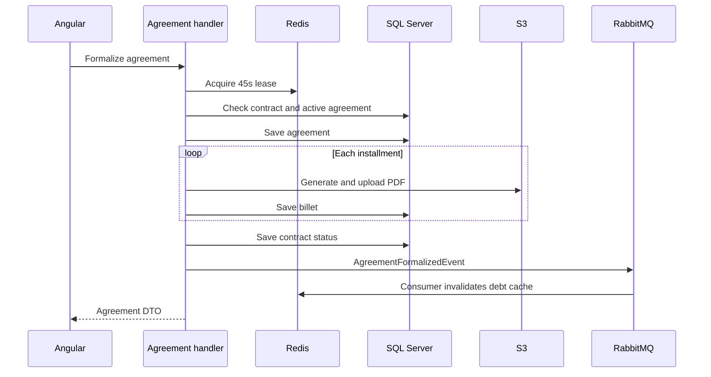

# invoice-generator-c: Contexto e fluxos do projeto

GitPageDocs **0.0.17** · 1.0.0 · 2026-10-29

## Contexto

Aplicação de contratos de cobrança, cálculo de dívida, negociação de acordos e emissão de documentos de parcelas. O backend é C#/.NET, apesar do sufixo -c. Boletos e códigos gerados têm caráter demonstrativo: a formalização não registra cobrança em banco nem confirma pagamento bancário.

## Stack e arquitetura

ASP.NET Core net9.0 com EF Core 9.0.2/SQL Server, MediatR 14.1, FluentValidation, MassTransit 8.3.1/RabbitMQ, Redis e QuestPDF 2026.2.4; Angular 19.2.19, TypeScript 5.7 e RxJS 7.8 no frontend. API, Application, Domain e Infrastructure separam HTTP, comandos/queries, entidades e adaptadores. S3 pode ser atendido pelo LocalStack. Não existe garantia automática de transação distribuída entre SQL, S3 e RabbitMQ.

## Fluxos completos

1. Cadastro → validação de senha/usuário → hash de senha → login → JWT e cookie HttpOnly/Secure/SameSite=Strict. O login também devolve Token no JSON. Controllers e ContractAccessService aplicam papéis e acesso ao contrato. Administração de usuários e contratos fica em AdminPanel; o catálogo HTTP está na referência.

2. Contrato → parcelas → cálculo por carteira. Para cada parcela, diasEmAtraso=max(0, dataReferência-dataVencimento); multa=principal×percentual/100 apenas se atrasada; juros=principal×(taxaMensal/100/diasPorMês)×diasEmAtraso. As taxas vêm de AppSettings; diasPorMês recai em 30 quando inválido. CurrentValue soma principal, multa e juros. A query usa cache e respeita acesso ao contrato.

3. Formalização valida de 1 a 24 parcelas, adquire Redis formalize:{contractId} por 45 segundos, verifica acesso e acordo ativo. Trava indisponível retorna 409; acordo ativo retorna 400. Gera Agreement e Billets, divide o valor com arredondamento a duas casas e vencimentos em intervalos de 30 dias. QuestPDF gera PDFs no próprio handler, antes da publicação do evento.

4. Cada PDF segue ao adaptador de armazenamento; se o upload falha, o handler grava uma URL mock. O contrato muda para Negotiated e publica AgreementFormalizedEvent. O consumer invalida o cache de dívida e grava idem:agreement:{id} no Redis por 30 dias; ele não gera os PDFs. A consulta de boleto verifica acesso e tenta recuperar o PDF, com fallback HTML conforme o serviço.

5. GenericRepository.AddAsync e UpdateAsync chamam SaveChangesAsync imediatamente. Agreement é persistido antes do loop de PDFs, cada Billet após seu upload e o contrato antes do evento. Não há transação envolvendo a formalização inteira; uma falha intermediária pode deixar acordo ou parcelas parciais. Confira o estado persistido antes de tentar novamente.

## Dados, segurança e limites

Entidades centrais: User/Role, Contract/Installment, Agreement/Billet, ContractHistory e AuditLog. Validação usa FluentValidation e regras do domínio; o acesso ao contrato é compartilhado entre consulta e formalização. O armazenamento possui um adaptador de proteção AES-GCM. Não confunda criptografia de payload com anonimização de logs. O lock tem expiração fixa; deduplicação do consumer é verificação seguida de gravação, não uma prova de exactly-once. Arredondamento uniforme pode deixar diferença residual entre soma das parcelas e total negociado.

## Execução, testes e operação

Copie envexample.txt para .env e configure valores locais; Docker Compose reúne SQL Server/inicialização, API, Redis, RabbitMQ, Elasticsearch, LocalStack e Angular. As portas efetivas são as do Compose. Fora do Docker, use SDK .NET 9 e npm ci no frontend; prestart/prebuild sincronizam ambiente da raiz. Valide dotnet test, dotnet build, npm test e npm run build. Em boleto indisponível, confira PdfUrl, S3 e fallback; em dívida desatualizada, cache e consumer; em 409, a duração do lock. O workflow existente publica documentação, não esses serviços.

## Referência completa

Dependências, comandos, endpoints, variáveis, contratos e testes estão na [referência do código](?menu=pt&lang=pt&id=20).

## Fontes verificáveis

- [backend/Application/Commands/CreateAgreementCommandHandler.cs](https://github.com/Vidigal-code/invoice-generator-c/blob/b1c5e2caf2d2a95fb06005b0d61d64792950207c/backend/Application/Commands/CreateAgreementCommandHandler.cs)

- [backend/Application/Consumers/AgreementFormalizedConsumer.cs](https://github.com/Vidigal-code/invoice-generator-c/blob/b1c5e2caf2d2a95fb06005b0d61d64792950207c/backend/Application/Consumers/AgreementFormalizedConsumer.cs)

- [backend/Application/Debt/InvoiceGeneratorCDebtCalculationStrategy.cs](https://github.com/Vidigal-code/invoice-generator-c/blob/b1c5e2caf2d2a95fb06005b0d61d64792950207c/backend/Application/Debt/InvoiceGeneratorCDebtCalculationStrategy.cs)

- [backend/Application/Services/Contracts/ContractAccessService.cs](https://github.com/Vidigal-code/invoice-generator-c/blob/b1c5e2caf2d2a95fb06005b0d61d64792950207c/backend/Application/Services/Contracts/ContractAccessService.cs)

- [backend/Application/Queries/GetBilletPdfQueryHandler.cs](https://github.com/Vidigal-code/invoice-generator-c/blob/b1c5e2caf2d2a95fb06005b0d61d64792950207c/backend/Application/Queries/GetBilletPdfQueryHandler.cs)

- [backend/Infrastructure/Configuration/AppSettings.cs](https://github.com/Vidigal-code/invoice-generator-c/blob/b1c5e2caf2d2a95fb06005b0d61d64792950207c/backend/Infrastructure/Configuration/AppSettings.cs)

- [docker-compose.yml](https://github.com/Vidigal-code/invoice-generator-c/blob/b1c5e2caf2d2a95fb06005b0d61d64792950207c/docker-compose.yml)

- [backend/Infrastructure/Repositories/GenericRepository.cs](https://github.com/Vidigal-code/invoice-generator-c/blob/b1c5e2caf2d2a95fb06005b0d61d64792950207c/backend/Infrastructure/Repositories/GenericRepository.cs)
